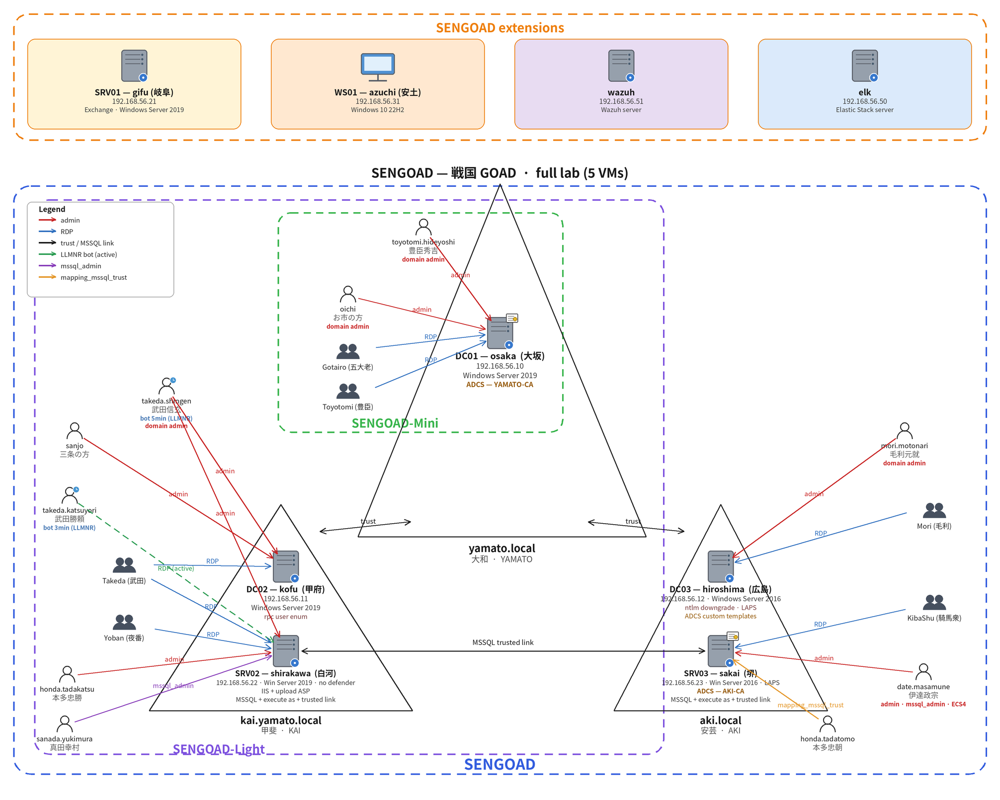
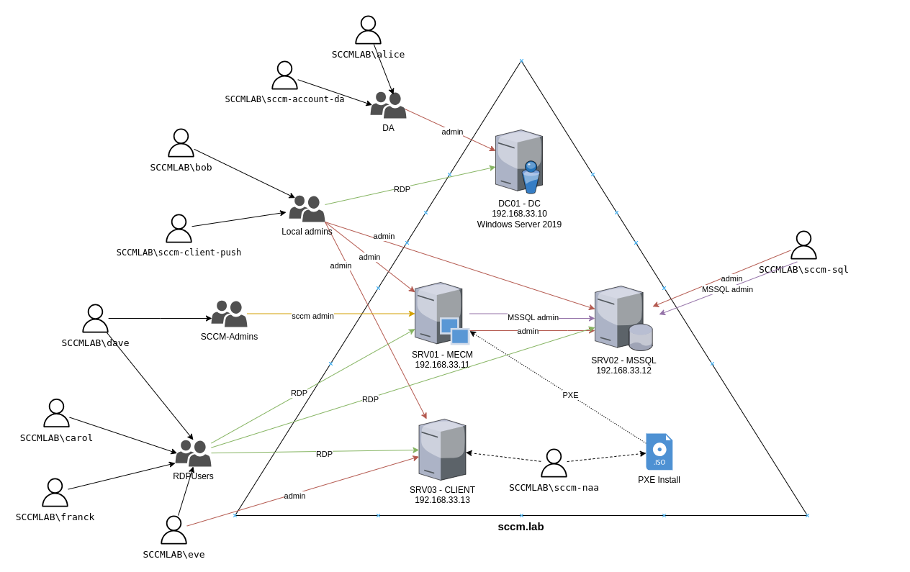

# Labs

- Practice lab(s) :
    - SENGOAD family:
        - [SENGOAD](GOAD.md) : 5 VMs, 2 forests, 3 domains (full SENGOAD lab)
        - [SENGOAD-Light](GOAD-Light.md) : 3 VMs, 1 forest, 2 domains (smaller SENGOAD lab for those with a smaller PC)
        - [SENGOAD-Mini](GOAD-Mini.md) : 1 VM, 1 domain (only yamato.local, minimalist lab)

        
   
    - [SCCM](SCCM.md) : 4 vms, 1 forest, 1 domain, with microsoft configuration manager installed
    

- Challenge lab :
    - [NHA](NHA.md) : A challenge with 5 vms and 2 domains. no schema provided, you will have to find out how break it.

- POC lab :
    - [MINILAB](MINILAB.md): 2 vms, 1 forest, 1 domain (basic lab with one DC (windows server 2019) and one Workstation (windows 10))
